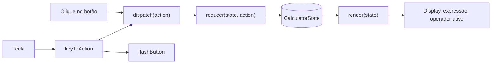

# Calculadora Design

**Spec**: `.specs/features/calculadora/spec.md`
**Status**: Approved
**Approved**: 2026-11-02 - user: "aprovado, com ERR-03"

---

## Architecture Overview

O PRD §6 já fixa a arquitetura: um reducer puro em `src/core/` e uma UI fina em `src/ui/` que só despacha ações e renderiza o estado. Não há alternativa a escolher. O que esta fase decide é onde cada regra mora, para que todas fiquem em código que os testes alcançam.



**Onde cada regra roda** (tudo o que muda o que o usuário vê fica em `src/core/` ou em dados puros testados):

| Regra | Camada | Prova |
| ----- | ------ | ----- |
| Entrada de dígitos, operadores, `=`, controles, erro | `core/calculator.ts` (reducer) | unit |
| Texto da expressão (`12 ×`, `2 + 3 =`) e operador ativo | `core/calculator.ts` (`expressionOf`, `activeOperator`) | unit |
| Arredondamento, zeros à direita, exponencial | `core/format.ts` (`formatResult`) | unit |
| Tamanho da fonte conforme o comprimento do texto | `core/format.ts` (`displaySize`) | unit |
| Tecla para ação, tecla com botão focado | `ui/keyboard.ts` (`resolveKey`, função pura) | unit |
| Grade, rótulos, `aria-label` | `ui/buttons.ts` (`BUTTONS`, lista de dados) | unit |
| Cores, contraste, tema, foco | `style.css`, lido por teste que calcula contraste | unit + walk |

O DOM (`render.ts`, `createButtons`, `bindKeyboard`, `main.ts`) só liga essas peças. Não tem regra própria.

---

## Code Reuse Analysis

Projeto novo: a pasta só tem `.specs/`. Não há código para reaproveitar.

### Existing Components to Leverage

| Component | Location | How to Use |
| --------- | -------- | ---------- |
| Nenhum | - | Projeto sem código. Stack e estrutura vêm do PRD §3 e §6 |

### Integration Points

| System | Integration Method |
| ------ | ------------------ |
| Vite | `index.html` carrega `src/main.ts`; `vite.config.ts` também guarda a config do Vitest |
| Vitest | `tests/*.test.ts`, ambiente `node`, cobertura `@vitest/coverage-v8` limitada a `src/core/**` |

---

## Components

### types

- **Purpose**: Tipos compartilhados do núcleo e da UI.
- **Location**: `src/core/types.ts`
- **Interfaces**:
  - `type Operator = '+' | '-' | '*' | '/'`
  - `type Action` - união discriminada: `{ type: 'digit'; digit: string }`, `{ type: 'decimal' }`, `{ type: 'operator'; operator: Operator }`, `{ type: 'equals' }`, `{ type: 'clear' }`, `{ type: 'clearEntry' }`, `{ type: 'backspace' }`, `{ type: 'negate' }`, `{ type: 'percent' }`
  - `interface CalculatorState` (ver Data Models)
- **Dependencies**: nenhuma.
- **Reuses**: modelo de estado do PRD §6, com dois campos a mais.

### operations

- **Purpose**: As quatro operações como funções puras sobre `number`.
- **Location**: `src/core/operations.ts`
- **Interfaces**:
  - `add(a: number, b: number): number`, `subtract`, `multiply`
  - `divide(a: number, b: number): number` - lança `DivisionByZeroError` quando `b === 0`
  - `class DivisionByZeroError extends Error`, `class NonFiniteResultError extends Error`
  - `applyOperator(op: Operator, a: number, b: number): number` - lança `NonFiniteResultError` quando o resultado não é finito
- **Dependencies**: `types`.
- **Reuses**: nada.

### format

- **Purpose**: Transformar `number` no texto do display e escolher o tamanho da fonte.
- **Location**: `src/core/format.ts`
- **Interfaces**:
  - `formatResult(value: number): string` - arredonda a 10 casas, remove zeros à direita, usa exponencial com até 10 casas quando o resultado tem mais de 15 dígitos
  - `countDigits(text: string): number` - só dígitos, sem sinal, ponto nem expoente
  - `displaySize(text: string): 'normal' | 'small' | 'tiny'` - faixas por comprimento
- **Dependencies**: nenhuma.
- **Reuses**: nada.

### calculator

- **Purpose**: Reducer e seletores. Única fonte das regras de comportamento.
- **Location**: `src/core/calculator.ts`
- **Interfaces**:
  - `initialState: CalculatorState`
  - `reducer(state: CalculatorState, action: Action): CalculatorState` - puro, sem mutação
  - `expressionOf(state: CalculatorState): string` - texto da linha secundária
  - `activeOperator(state: CalculatorState): Operator | null` - operador a destacar
- **Dependencies**: `types`, `operations`, `format`.
- **Reuses**: nada.

### buttons

- **Purpose**: Descrever a grade como dados e ligar os botões ao `dispatch`.
- **Location**: `src/ui/buttons.ts`
- **Interfaces**:
  - `BUTTONS: readonly ButtonSpec[]` - 21 itens na ordem da grade; cada um com `label`, `ariaLabel`, `action`, `kind: 'digit' | 'operator' | 'equals' | 'control'`, `span?: number`
  - `createButtons(root: HTMLElement, dispatch: (a: Action) => void): Map<string, HTMLButtonElement>`
  - `flashButton(button: HTMLElement): void` - adiciona a classe `pressed` por 120 ms
  - `markActive(buttons, operator: Operator | null): void`
- **Dependencies**: `types`.
- **Reuses**: nada.

### keyboard

- **Purpose**: Traduzir teclas em ações.
- **Location**: `src/ui/keyboard.ts`
- **Interfaces**:
  - `resolveKey(key: string, targetIsButton: boolean): Action | null` - pura; devolve `null` para `Enter` e `Space` com botão focado (KEY-05) e para teclas não mapeadas
  - `bindKeyboard(dispatch, buttons): () => void` - registra o `keydown`, chama `flashButton`, faz `preventDefault` em `/` e `Enter`
- **Dependencies**: `types`, `buttons`.
- **Reuses**: `BUTTONS` para achar o botão da ação.

### render

- **Purpose**: Escrever o estado no DOM.
- **Location**: `src/ui/render.ts`
- **Interfaces**:
  - `render(state: CalculatorState, els: DisplayElements): void` - define o texto do número, o texto da expressão, o `data-size` do display e o operador ativo
- **Dependencies**: `calculator` (`expressionOf`, `activeOperator`), `format` (`displaySize`), `buttons` (`markActive`).
- **Reuses**: seletores do reducer.

### main

- **Purpose**: Ponto de entrada. Cria o estado, o `dispatch`, monta botões e teclado.
- **Location**: `src/main.ts`
- **Interfaces**: nenhuma exportada.
- **Dependencies**: `calculator`, `render`, `buttons`, `keyboard`.
- **Reuses**: tudo acima.

### page and styles

- **Purpose**: Estrutura HTML e visual.
- **Location**: `index.html`, `src/styles/style.css`
- **Interfaces**:
  - `#expression` e `#display` com `aria-live="polite"` no display
  - `#keys` com `display: grid; grid-template-columns: repeat(4, 1fr)`; a classe `.span-4` faz o `=` ocupar a linha toda
  - Pares de variáveis `--<papel>-fg` e `--<papel>-bg` nos temas claro e escuro, para o teste de contraste (`display`, `key`, `operator`, `equals`, `control`, `active`)
- **Dependencies**: `main.ts`.
- **Reuses**: nada.

---

## Data Models

```typescript
type Operator = '+' | '-' | '*' | '/'

interface LastOperation {
  operator: Operator
  left: string      // valor à esquerda da última execução; vira o resultado a cada `=` repetido
  operand: string
}

interface CalculatorState {
  currentValue: string          // número digitado ou exibido
  previousValue: string | null  // acumulado à esquerda do operador pendente
  operator: Operator | null
  lastOperation: LastOperation | null   // para `=` repetido e para a expressão `2 + 3 =`
  waitingForOperand: boolean    // um operador acabou de ser acionado
  afterResult: boolean          // o display mostra o resultado de um `=`
  error: string | null
}
```

**Diferenças em relação ao PRD §6:**
- `lastOperation.left` é novo: sem ele a expressão `2 + 3 =` não tem como ser reconstruída depois do cálculo.
- `afterResult` é novo: separa "acabei de calcular" de "estou esperando o segundo número". Precisam de comportamentos diferentes (CTRL-02 AC 3, CTRL-03 AC 5, CALC-09).

**Regras de transição que a spec deixa para o design:**
- `%`, `±` e `CE` só mexem em `currentValue` (e `CE` zera `waitingForOperand`); não alteram `afterResult`.
- `⌫` é ignorado quando `afterResult` ou `waitingForOperand` é verdadeiro.
- `=` com operador pendente tem prioridade sobre `afterResult`; sem operador pendente repete `lastOperation`; sem nenhum dos dois não faz nada.
- Operador após resultado continua do resultado: `previousValue = currentValue`, `afterResult = false`.
- Dígito com `afterResult` zera tudo e começa o número novo; dígito com `waitingForOperand` substitui o número exibido.

---

## Error Handling Strategy

| Error Scenario | Handling | User Impact |
| -------------- | -------- | ----------- |
| Divisão por zero | `divide` lança `DivisionByZeroError`; o reducer captura e define `error` | Display mostra `Não é possível dividir por zero` e as demais ações são ignoradas até `C` ou dígito |
| Resultado não finito (`Infinity`) | `applyOperator` lança `NonFiniteResultError`; o reducer captura como na divisão por zero (ERR-03) | Display mostra `Resultado fora do limite` e as demais ações são ignoradas até `C` ou dígito |
| Tecla sem mapa | `resolveKey` devolve `null` | Nada acontece |
| Elemento do DOM ausente em `main.ts` | Lança erro na montagem | Falha visível no console em vez de tela quebrada em silêncio |

---

## Risks & Concerns

| Concern | Location (file:line) | Impact | Mitigation |
| ------- | -------------------- | ------ | ---------- |
| Resultado não finito: 20 multiplicações encadeadas de números de 15 dígitos chegam a `Infinity` | `src/core/operations.ts` (a criar) | O display mostraria `Infinity` | `ERR-03`, aprovado: mensagem `Resultado fora do limite`, tratada como o erro de divisão por zero |
| Resultado em exponencial seguido de `⌫` ou de dígito | `src/core/calculator.ts` (a criar) | Cortar `e+20` ao meio gera número inválido | `afterResult` bloqueia `⌫` e faz o dígito começar do zero |
| Arredondamento a 10 casas apaga valores muito pequenos (`1 ÷ 3000000000000` mostra `0`) | `src/core/format.ts` (a criar) | Resultado diz `0` em vez de `3.333e-13` | Segue o PRD RF06 (máximo 10 casas). Fica documentado no README |
| Resultado com mais de 15 dígitos perde precisão ao virar exponencial (`123456789012345.67`) | `src/core/format.ts` (a criar) | Mostra `1.2345678901e+14` | Segue a spec CALC-11 AC 19. Fica documentado no README |
| Contraste, tema e rolagem horizontal não têm teste de navegador | `src/styles/style.css` (a criar) | Regressão visual passa despercebida | Teste lê o CSS e calcula o contraste de cada par `-fg`/`-bg`; `walk` em 320 px e nos dois temas no fim |
| Repositório sem git | raiz do projeto | `check_proofs.py` e os commits por task não funcionam | Primeira task roda `git init` e cria `.gitignore` |

---

## Tech Decisions (only non-obvious ones)

| Decision | Choice | Rationale |
| -------- | ------ | --------- |
| Aritmética | `number` do JS com `formatResult` corrigindo a imprecisão | O PRD pede 10 casas e `0.1 + 0.2 = 0.3`; uma biblioteca decimal seria dependência de runtime (QUAL-04) |
| Estado dos números | `string`, não `number` | Preserva `0.`, `-0.5` e zeros digitados enquanto o usuário escreve |
| Tamanho da fonte | `displaySize` em `core/format.ts`, aplicado como `data-size` | UI-06 é regra visível: roda onde há teste, o CSS só escolhe o tamanho por atributo |
| Grade como dados | `BUTTONS` em `ui/buttons.ts` | UI-01 e A11Y-01 viram teste de lista, sem DOM nem jsdom |
| Ambiente de teste | Vitest em `node`, sem jsdom | Nada nos testes precisa de DOM; menos dependências |
| Configuração | `vite.config.ts` com o bloco `test`, sem `vitest.config.ts` | Um arquivo só; o PRD §6 lista `vite.config.ts` |
| ESLint | flat config com `typescript-eslint`, `--max-warnings 0` | QUAL-02 exige zero warnings |
| `%` | Divide `currentValue` por 100 e formata com `formatResult` | CTRL-05; `50 + 10 %` vira `50 + 0.1` |
| Layout 4x6 | `=` com `span-4` na última linha | Decidido com o usuário; mantém os 21 botões |
